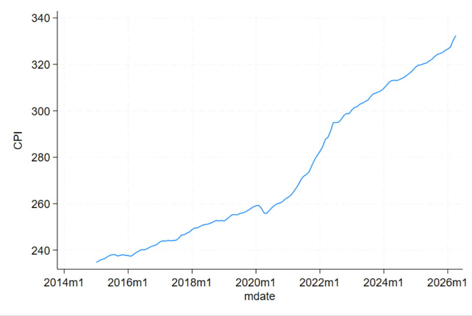
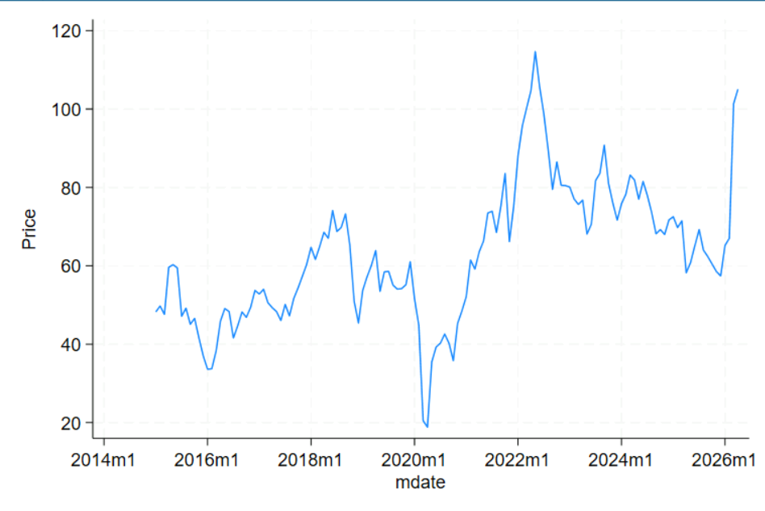
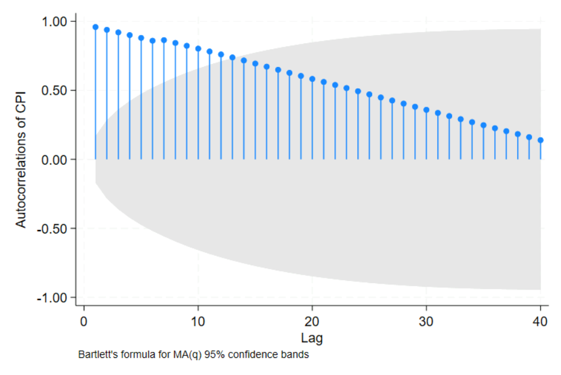
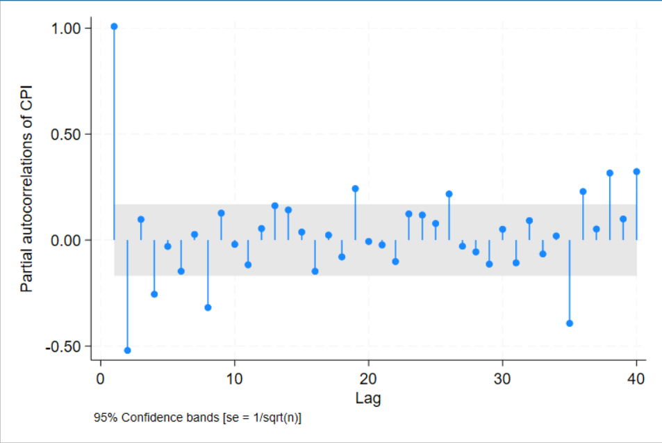
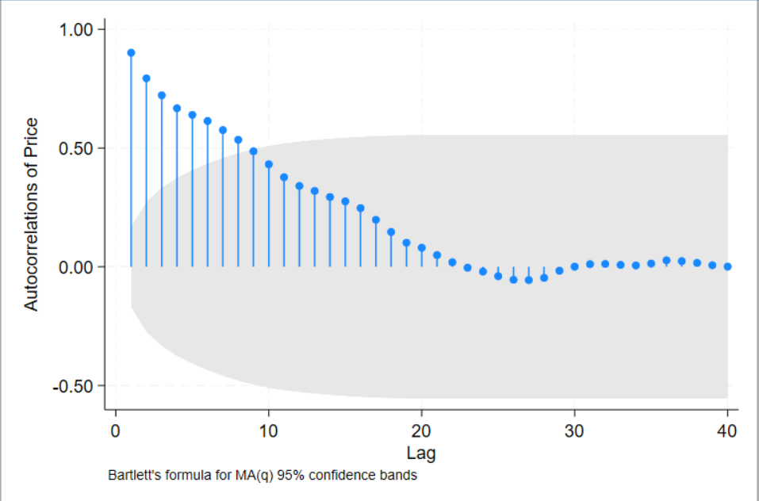
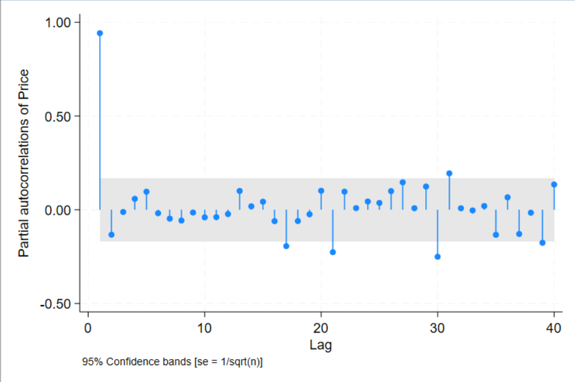
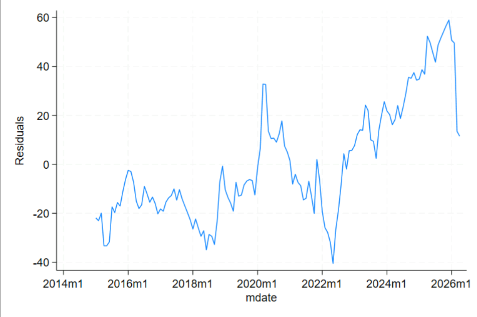

# Does crude oil drive US consumer prices?

A time-series study of WTI crude oil prices and the US Consumer Price Index, using 135 monthly observations from January 2015 to April 2026. Written for the Advanced Business Statistics module of my MBA at Middlesex University Dubai. All estimation was done in Stata.

## Result

Oil prices and CPI look related: the correlation is 0.65 and a regression of CPI on the oil price is highly significant. The relationship does not survive a cointegration test. Both series are non-stationary, the regression residuals are non-stationary too, and the significant coefficient is most likely a spurious regression.

## Data

| Series | Source | Mean | Std. dev. | Min | Max |
|---|---|---|---|---|---|
| US CPI, all urban consumers | FRED (CPIAUCSL) | 273.30 | 30.72 | 234.75 | 332.41 |
| WTI crude, USD per barrel | Investing.com historical data | 62.97 | 17.58 | 18.84 | 114.67 |

CPI climbs steadily and steepens from 2021. Oil has no lasting trend. It collapses in early 2020 and peaks in 2022.

| CPI | WTI crude |
|---|---|
|  |  |

## Method and findings

### 1. Autocorrelation

The CPI autocorrelations fall slowly and are still positive at lag 40, the pattern of a trending, non-stationary series. Its partial autocorrelation has one dominant spike at lag 1 and a negative one at lag 2. Oil price autocorrelations fade to zero by about lag 22, with a single partial spike at lag 1.

| ACF, CPI | PACF, CPI |
|---|---|
|  |  |

| ACF, WTI | PACF, WTI |
|---|---|
|  |  |

### 2. Unit root tests (Augmented Dickey-Fuller)

| Series | Test statistic | p-value | Conclusion |
|---|---|---|---|
| CPI, level | 3.836 | 1.000 | Non-stationary |
| CPI, first difference | -5.833 | 0.000 | Stationary |
| WTI, first difference | -10.363 | 0.000 | Stationary |

Both series are treated as integrated of order one.

### 3. OLS regression of CPI on the oil price

| Coefficient on WTI | p-value | R² | Observations |
|---|---|---|---|
| 1.131 | 0.000 | 0.4193 | 135 |

Taken at face value, each extra dollar per barrel goes with 1.13 more CPI index points.

### 4. Engle-Granger cointegration test

| ADF statistic on residuals | 5% critical value | Conclusion |
|---|---|---|
| -2.120 | -3.382 | Cannot reject "no cointegration" |

The residuals trend upward over the sample, so there is no stable long-run relationship for the regression to describe.

## What this means

Oil is one driver of inflation among several, and this sample gives no evidence that it anchors the long-run price level. A model that forecasts CPI from the oil price in levels would look good in sample and fail out of it.

## Limitations

- The model has two variables and leaves out interest rates, wages and supply-chain conditions.
- Engle-Granger has low power when there are structural breaks, and this sample contains COVID-19 and the Russia-Ukraine war.
- The unit root test for oil was run on the first difference only.

The next steps would be a regression in first differences, a Zivot-Andrews test for breaks, and a multivariate model.
